<div align = center>

# LCDBigNumbers
Arduino library to write big numbers on a 1602 or 2004 LCD.

[](https://www.gnu.org/licenses/gpl-3.0)
 &nbsp; &nbsp;
[](https://github.com/ArminJo/LCDBigNumbers/releases/latest)
 &nbsp; &nbsp;
[](https://github.com/ArminJo/LCDBigNumbers/commits/master)
 &nbsp; &nbsp;
[](https://github.com/ArminJo/LCDBigNumbers/actions)
 &nbsp; &nbsp;

<br/>
<br/>
[](https://stand-with-ukraine.pp.ua)

Available as [Arduino library "LCDBigNumbers"](https://www.arduinolibraries.info/libraries/lcd-big-numbers).

</div>

#### If you find this library useful, please give it a star.

&#x1F30E; [Google Translate](https://translate.google.com/translate?sl=en&u=https://github.com/ArminJo/LCDBigNumbers)

<br/>

# Features
- **10 different fonts available. From 1x2 up to 3x4.**
- Support for special big characters `-`, `.` and `:`.
- All `print()` functions with base <= 10 can be used, including the ones for floating point numbers.
- Fonts which require no gap between numbers (1x2 and 3x2, variant 2 and 3) are printed by default without this gap.
- Support for **parallel and serial** LCD connections.
- For all architectures.

<br/>

# Usage

```c++
// Choose your display
//#define USE_PARALLEL_2004_LCD // Is default
//#define USE_PARALLEL_1602_LCD
//#define USE_SERIAL_2004_LCD
//#define USE_SERIAL_1602_LCD
#include "LCDBigNumbers.hpp" // Include sources for LCD big number generation

LiquidCrystal myLCD(2, 3, 4, 5, 6, 7); // Depends on your actual connections
LCDBigNumbers bigNumberLCD(&myLCD, BIG_NUMBERS_FONT_3_COLUMN_4_ROWS_VARIANT_1); // Use 3x4 numbers, 1. variant

void setup() {
    myLCD.begin(LCD_COLUMNS, LCD_ROWS); // LCD_COLUMNS and LCD_ROWS are set by LCDBigNumbers.hpp depending on the defined display
    bigNumberLCD.begin(); // Creates custom character used for generating big numbers

    bigNumberLCD.print(-47.11, 2); // Use the standard print function for floating point. Cursor is at 0 0 after booting.
    delay(2000);
    bigNumberLCD.setBigNumberCursor(0, 0); // Here the row specification is redundant because it is a 4 row font :-)
    bigNumberLCD.print(F(ONE_COLUMN_HYPHEN_STRING ONE_COLUMN_SPACE_STRING "47.11:")); // Print the same number string with an additional trailing colon
}
```
For a **serial (I2C) LCD** use:

```c++
#define USE_SERIAL_2004_LCD
#include "LCDBigNumbers.hpp" // Include sources for LCD big number generation

LiquidCrystal_I2C myLCD(0x27, LCD_COLUMNS, LCD_ROWS); // 0x27 is the default I2C address
LCDBigNumbers bigNumberLCD(&myLCD, BIG_NUMBERS_FONT_3_COLUMN_4_ROWS_VARIANT_1); // Use 3x4 numbers, 1. variant

void setup() {
    myLCD.init();
    myLCD.backlight(); // Switch backlight LED on
    bigNumberLCD.begin(); // Creates custom character used for generating big numbers
    bigNumberLCD.print(F("47.11"));
}
```

## Characters
| Input | Rendered as |
|-|-|
| `0` to `9` or byte values 0 to 9 | Big number, followed by a one column gap, if the gap is enabled. |
| `-` | Hyphen / minus of one column, followed by the gap. |
| `_` (`ONE_COLUMN_HYPHEN_CHARACTER`) | Hyphen / minus of one column without gap. |
| `.` and `:` | One column wide, without gap. |
| space | Blank with the width and the gap of a number. |
| `\|` (`ONE_COLUMN_SPACE_CHARACTER`) | Blank of one column with the height of a number. |
| any other character | Skipped, nothing is printed. |

For use in strings, there are `ONE_COLUMN_SPACE_STRING` and `ONE_COLUMN_HYPHEN_STRING` like in the example above.

<br/>

# Available fonts
| Identifier | Size<br/>(columns x rows) | Gap between numbers<br/>by default |
|-|-|-|
| `BIG_NUMBERS_FONT_1_COLUMN_2_ROWS` | 1x2 | no |
| `BIG_NUMBERS_FONT_2_COLUMN_2_ROWS` | 2x2 | yes |
| `BIG_NUMBERS_FONT_3_COLUMN_2_ROWS_VARIANT_1` | 3x2 | yes |
| `BIG_NUMBERS_FONT_3_COLUMN_2_ROWS_VARIANT_2` | 3x2 | no |
| `BIG_NUMBERS_FONT_3_COLUMN_2_ROWS_VARIANT_3` | 3x2 | no |
| `BIG_NUMBERS_FONT_2_COLUMN_3_ROWS_VARIANT_1` | 2x3 | yes |
| `BIG_NUMBERS_FONT_2_COLUMN_3_ROWS_VARIANT_2` | 2x3 | yes |
| `BIG_NUMBERS_FONT_3_COLUMN_3_ROWS` | 3x3 | yes |
| `BIG_NUMBERS_FONT_3_COLUMN_4_ROWS_VARIANT_1` | 3x4 | yes |
| `BIG_NUMBERS_FONT_3_COLUMN_4_ROWS_VARIANT_2` | 3x4 | yes |

The fonts with 3 or 4 rows are only available for 2004 displays.

<br/>

# API
**Only print functions with base <= 10 like print(1234, 8) are available because Hex characters are NOT supported!**

```c++
LCDBigNumbers(LiquidCrystal *aLCD, const uint8_t aBigNumberFontIdentifier); // or LiquidCrystal_I2C *aLCD for serial LCD
void begin(); // Call it in setup() AFTER the LCD is initialized. Generates the font symbols in the LCD controller.
void loadFont(const uint8_t aBigNumberFontIdentifier); // Reconfigure existing object to hold another font and generate its font symbols. Sets LCD cursor to 0,0.
void setBigNumberCursor(uint8_t aUpperLeftColumnIndex, uint8_t aUpperLeftRowIndex = 0);
size_t write(uint8_t aNumberOrSpecialCharacter); // Used by all print() functions
size_t writeBigNumber(uint8_t aNumberOrSpecialCharacter); // Returns the number of columns written or 10 for  skipped characters
size_t writeAt(uint8_t aNumber, uint8_t aUpperLeftColumnIndex, uint8_t aUpperLeftRowIndex = 0);
void enableGapBetweenNumbers();
void disableGapBetweenNumbers();
void setGapBetweenNumbers(bool aForceGapBetweenNumbers);

void testBigNumbers(LCDBigNumbers *aBigNumberLCD); // Print all fonts, used in screenshots below, using the object passed
```

# Notes
- Call `begin()` after the initialization of the LCD.
- A font occupies all 8 custom characters of the LCD. Therefore only one font can be used at a time and no own custom characters are possible.
- To change the font at runtime, use `loadFont()`. It selects the font and generates its custom characters, so no additional `begin()` is required.
- `loadFont()` does not clear the display. Big numbers already displayed with another font must be cleared or overwritten.
- The fonts use the character codes 0xFF (full block), 0xFE (blank) and 0xA5 (centered dot) of the standard HD44780 character ROM (A00).

<br/>

# Examples
- **BigNumbersDemo**: Shows all fonts using `testBigNumbers()`. [Run it on Wokwi](https://wokwi.com/projects/346534078384702034).
- **SimpleClock**: A (fast) running clock with blinking colon using the 3x3 font. [Run it on Wokwi](https://wokwi.com/projects/346661429974139474).
- **SimpleLCDBigNumbers**: Minimal example, which prints a floating point number and a string with the 3x4 font.
- **MCP9808TemperatureOnLCD**: Shows the temperature of a MCP9808 sensor on a 2004 LCD. A button at pin 2 toggles between the 3x4 and the 3x3 font.

# Screenshots
Screenshots of [BigNumbersDemo example](https://github.com/ArminJo/LCDBigNumbers/tree/master/examples/BigNumbersDemo).

| Size<br/>ColxRow | Variant<br/>Number |  |  |  |
|-|-|-|-|-|
| 1x2 | 1 | 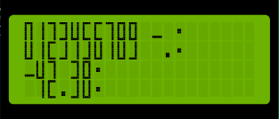  |  |  |
| 2x2 | 1 | 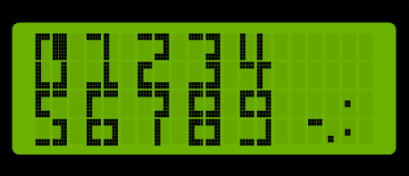  |  | 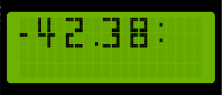 |
| 3x2 | 1 | 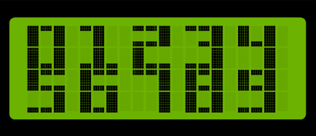  |  | 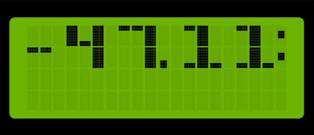 |
| 3x2 | 2 | 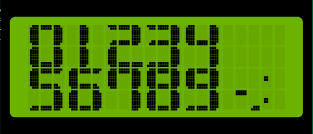  |  | 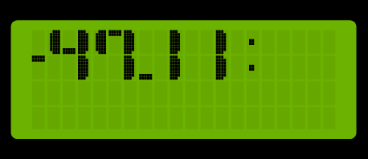 |
| 3x2 | 3 | 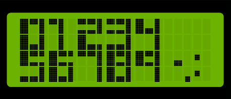  |  | 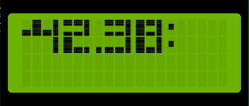 |
| 2x3 | 1 | 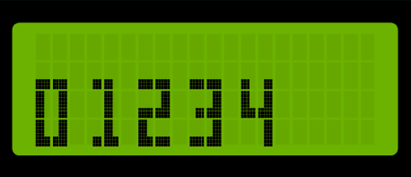 | 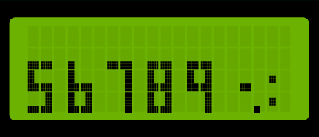 | 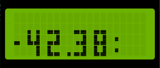 |
| 2x3 | 2 | 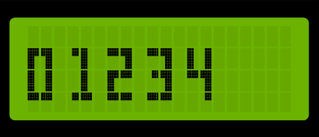 | 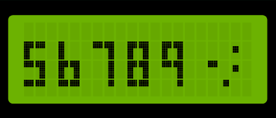 | 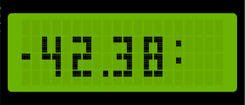 |
| 3x3 | 1 | 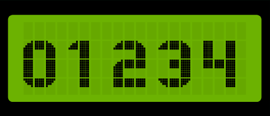 | 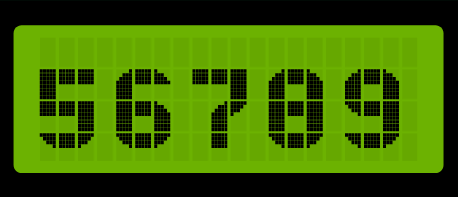 | 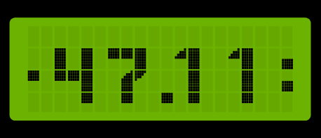 |
| 3x4 | 1 | 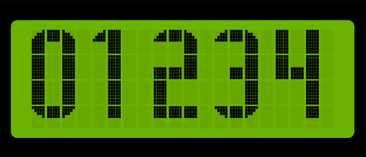 | 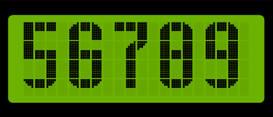 | 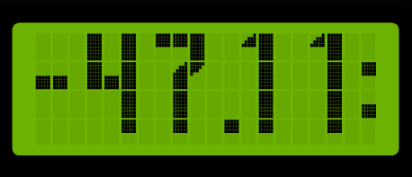 |
| 3x4 | 2 | 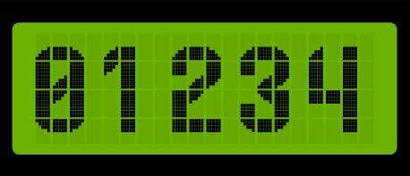 | 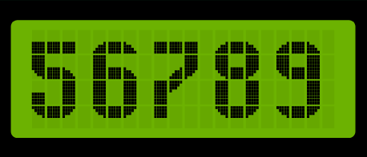 | 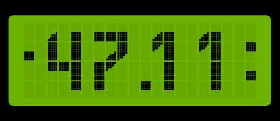 |

<br/>

# Compile options / macros for this library
To customize the library to different requirements, there are some compile options / macros available.<br/>
These macros must be defined in your program **before** the line `#include "LCDBigNumbers.hpp"` to take effect.<br/>
Modify them by enabling / disabling them, or change the values if applicable.

| Name | Default value | Description |
|-|-:|-|
| `USE_PARALLEL_2004_LCD` `USE_PARALLEL_1602_LCD` | USE_PARALLEL_2004_LCD is default | Use parallel 6 or 10 wire LCD connection with the [Arduino LiquidCrystal library](https://docs.arduino.cc/libraries/liquidcrystal/). |
| `USE_SERIAL_2004_LCD` `USE_SERIAL_1602_LCD` | not defined | Use serial 4 wire LCD connection. An enhanced copy of the [LiquidCrystal_I2C library](https://github.com/marcoschwartz/LiquidCrystal_I2C) is included in this library. |
| `USE_SOFT_I2C_MASTER` | defined automatically on AVR, if `SoftI2CMasterConfig.h` is found | Use SoftI2CMaster instead of Wire for the serial LCD, which saves program space. |

The macros `LCD_COLUMNS` and `LCD_ROWS` are set by the library depending on the display chosen.

# Why *.hpp instead of *.cpp?
**Every \*.cpp file is compiled separately** by a call of the compiler exclusively for this cpp file. These calls are managed by the IDE / make system.
In the Arduino IDE the calls are executed when you click on *Verify* or *Upload*.

And now **our problem with Arduino** is:<br/>
**How to set [compile options](#compile-options--macros-for-this-library) for all *.cpp files, especially for libraries used?**<br/>
IDE's like [Sloeber](https://github.com/Arduino-IRremote/Arduino-IRremote?tab=readme-ov-file#modifying-compile-options--macros-with-sloeber-ide) or
[PlatformIO](https://github.com/Arduino-IRremote/Arduino-IRremote?tab=readme-ov-file#modifying-compile-options--macros-with-platformio) support this by allowing to specify a set of options per project.
They add these options at each compiler call e.g. `-DTRACE`.

But Arduino lacks this feature. So the **workaround** is not to compile all sources separately, but to concatenate them to one huge source file by including them in your source.
This is done by e.g. `#include "LCDBigNumbers.hpp"`.
<br/>
But why not `#include "LCDBigNumbers.cpp"`?<br/>
Try it and you will see tons of errors, because each function of the *.cpp file is now compiled twice,
first by compiling the huge file and second by compiling the *.cpp file separately, like described above.
So using the extension *cpp* is not longer possible, and one solution is to use *hpp* as extension, to show that it is an included *.cpp file.
Every other extension e.g. *cinclude* would do, but *hpp* seems to be common sense.

<br/>

# Revision History
### Version 1.3.0
- Fixed: Bug of clearing the gap after a number which ends at the last column of the display.
- Fixed: Fallback to the 2x2 font for an invalid font identifier.
- Changed: Renamed `init()` to `loadFont()`, which now also generates the custom characters of the new font.
- Changed: `testBigNumbers()` now requires a pointer to a `LCDBigNumbers` object instead of a pointer to the LCD object.
- Changed: Characters other than `0x00` to `0x09` and `0` to `9` and ` |-_.:` are now skipped instead of being printed as a blank.
- Changed: Trailing `_VARIANT_1` for font names which have no variants is now deprecated.
- Changed: Swapped pictures of BIG_NUMBERS_FONT_3_COLUMN_2_ROWS_VARIANT_2 and BIG_NUMBERS_FONT_3_COLUMN_2_ROWS_VARIANT_3 to reflect the code.
- Added: Example MCP9808TemperatureOnLCD.

### Version 1.2.3
- Fixed: Bug in clearing the gap between numbers.

### Version 1.2.2
- Changed: Improved _createChar().
- Added: `VERSION_LCD_BIG_NUMBERS`.

### Version 1.2.1
- Fixed: Bug of not working forceGapBetweenNumbers for BIG_NUMBERS_FONT_1_COLUMN_2_ROWS_VARIANT_1.

### Version 1.2.0
- Added: Support for floating point numbers.

### Version 1.1.1
- Removed: Compiler warning.

### Version 1.1.0
- Changed: Handling of space and therefore introduced `ONE_COLUMN_SPACE_STRING` and `ONE_COLUMN_SPACE_CHARACTER`.

### Version 1.0.0
- Initial Arduino library version.
